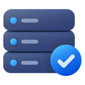
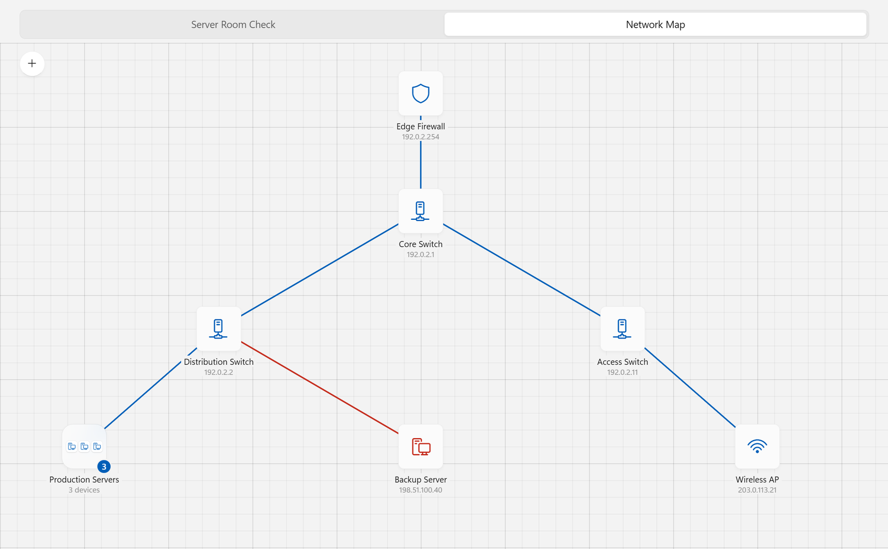
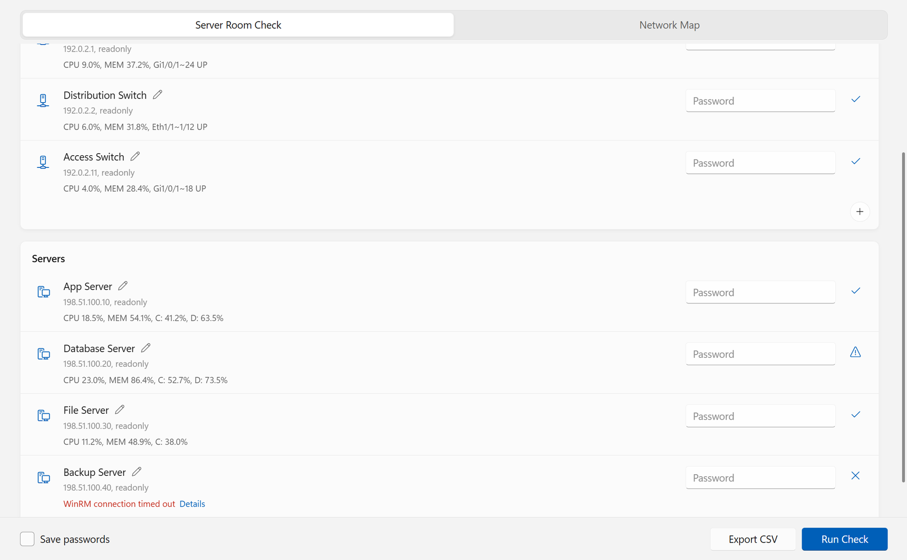

<div align="center">



# RackCheck

**서버실을 위한 조회 전용 상태 점검 및 실시간 네트워크 맵**

Cisco IOS, Cisco NX-OS, Palo Alto, Windows Server를 하나의 데스크톱 앱에서 점검합니다.


[](LICENSE)

[English](README.md) | **한국어**

<picture>
  <source media="(prefers-color-scheme: dark)" srcset="docs/network-map-dark.png">
  
</picture>

</div>

## RackCheck를 만든 이유

서버실 정기 점검은 장비마다 접속해 같은 명령을 실행하고 수치를 손으로 옮겨 적는 일이 많습니다. RackCheck는 이 과정을 한 번에 수행하고 깔끔한 기록으로 남깁니다.

- **조회 전용:** 조회 명령만 실행하며 장비 설정을 변경하지 않습니다.
- **파일에 남지 않는 비밀번호:** 저장한 비밀번호는 `config.json`이 아니라 Windows 자격 증명 관리자에 보관합니다.
- **다시 쓰기 쉬운 결과:** 점검 결과를 정형화된 CSV로 내보내 스프레드시트나 스크립트에서 바로 활용할 수 있습니다.

## 주요 기능

**상태 점검:** CPU, 메모리, 포트, 디스크 상태를 수집하고 장비별로 정상, 이상, 실패를 표시합니다.

**네트워크 맵:** 장비를 배치하고 링크를 연결하며 묶음으로 정리할 수 있습니다. 상태는 Ping과 TCP 확인으로 5초마다 갱신됩니다.

**CSV 내보내기:** 오늘의 점검 결과를 장비당 한 줄로 저장합니다.

**방화벽 캡처:** Palo Alto 대시보드 화면을 이미지로 저장합니다.

<div align="center">
<picture>
  <source media="(prefers-color-scheme: dark)" srcset="docs/inspection-dark.png">
  
</picture>
</div>

## 지원 장비

| 플랫폼 | 접속 방식 | 수집 항목 |
|---|---|---|
| Cisco IOS | SSH | CPU, 메모리, 포트 |
| Cisco NX-OS | SSH | CPU, 메모리, 포트 |
| Palo Alto PAN-OS | SSH | CPU, 메모리, 포트 |
| Windows Server | WinRM | CPU, 메모리, 디스크 |

## 시작하기

### 다운로드

1. [최신 릴리즈](../../releases/latest)에서 `RackCheck.exe`를 내려받습니다.
2. `D:\RackCheck`처럼 쓰기 권한이 있는 폴더에 넣습니다.
3. 실행한 뒤 장비를 추가합니다.

[WebView2 런타임](https://developer.microsoft.com/microsoft-edge/webview2/)이 필요합니다. Windows 11에는 기본으로 포함되어 있습니다.

### 소스로 실행

```powershell
pip install -r requirements.txt
python Source.py
```

### 빌드

```powershell
.\build.bat
```

실행 파일은 `dist\RackCheck.exe`에 생성됩니다.

## 설정

장비는 앱에서 추가할 수 있으며 실행 파일 옆의 `config.json`에 저장됩니다. 직접 작성하려면 [`config.example.json`](config.example.json)을 참고하세요.

`config.json`에는 장비 주소와 계정 이름이 들어 있어 Git에서 제외됩니다.

## CSV 형식

UTF-8(BOM) 형식이며 장비 한 대당 한 줄입니다. CPU 또는 메모리가 80% 이상이거나 디스크가 90% 이상이면 `abnormal`로 판정합니다.

<details>
<summary>열 구성 보기</summary>

| 열 | 내용 |
|---|---|
| `checked_at` | 점검 시각 (ISO 8601) |
| `name` | 장비 이름 |
| `category` | `network`, `server` |
| `device_type` | `cisco_ios`, `cisco_nxos`, `paloalto_panos`, `windows` |
| `host` | IP 주소 또는 호스트 이름 |
| `status` | `normal`, `abnormal`, `unknown`, `failed`, `skipped` |
| `cpu_percent` | CPU 사용률 |
| `memory_percent` | 메모리 사용률 |
| `ports_up` | UP 포트 요약 |
| `disk_usage` | 드라이브별 사용률 (예: `C:41.2;D:73.5`) |
| `error` | 실패 사유 |

</details>

## 보안

RackCheck는 신뢰할 수 있는 관리망에서 사용하는 것을 전제로 합니다. 사용 전에 다음 동작을 확인하세요.

- WinRM은 HTTP와 NTLM 인증으로 접속합니다.
- SSH 호스트 키를 검증하지 않습니다.
- 방화벽 캡처는 웹 화면에 로그인하며 자체 서명 인증서를 허용합니다.
- 네트워크 맵은 맵에 있는 모든 장비로 Ping과 TCP 연결을 시도합니다.

가능하면 장비마다 조회 전용 계정을 사용하세요. 취약점은 공개 이슈 대신 GitHub 보안 권고로 비공개 제보해 주세요.

## 라이선스

[MIT 라이선스](LICENSE)로 배포합니다.
