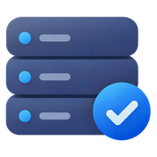
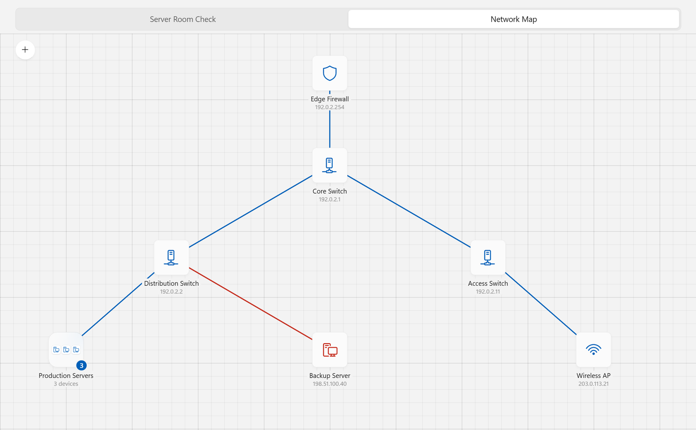
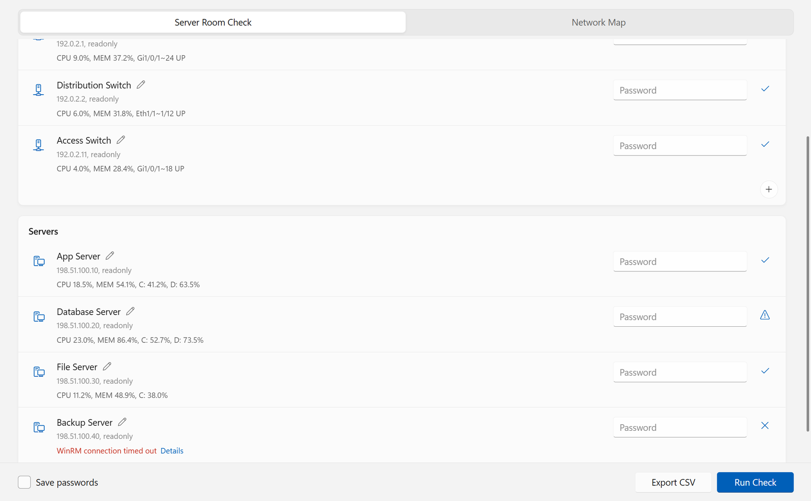

<div align="center">



# RackCheck

**Read-only health checks and a live network map for your server room.**

Cisco IOS, Cisco NX-OS, Palo Alto, and Windows Server in one desktop app.


[](LICENSE)

**English** | [한국어](README.ko.md)

<picture>
  <source media="(prefers-color-scheme: dark)" srcset="docs/network-map-dark.png">
  
</picture>

</div>

## Why RackCheck

Routine server room checks often mean signing in to each device, running the same commands, and copying the numbers by hand. RackCheck collects them in one pass and gives you a clean record.

- **Read-only by design.** Checks run query commands and never change device configuration.
- **Credentials stay out of files.** Saved passwords live in Windows Credential Manager, not in `config.json`.
- **Results you can reuse.** Every check exports to a structured CSV, ready for a spreadsheet or a script.

## Features

**Health checks.** Collect CPU, memory, port, and disk status, with each device marked as normal, abnormal, or failed.

**Network map.** Arrange devices, draw links, and group them into bundles. Status refreshes every 5 seconds using ping with a TCP fallback.

**CSV export.** Save the day's results with one row per device.

**Firewall capture.** Save a screenshot of the Palo Alto dashboard.

<div align="center">
<picture>
  <source media="(prefers-color-scheme: dark)" srcset="docs/inspection-dark.png">
  
</picture>
</div>

## Supported Devices

| Platform | Connection | Collected data |
|---|---|---|
| Cisco IOS | SSH | CPU, memory, ports |
| Cisco NX-OS | SSH | CPU, memory, ports |
| Palo Alto PAN-OS | SSH | CPU, memory, ports |
| Windows Server | WinRM | CPU, memory, disks |

## Quick Start

### Download

1. Download `RackCheck.exe` from the [latest release](../../releases/latest).
2. Place it in a folder you can write to, such as `D:\RackCheck`.
3. Run it and add your devices.

The [WebView2 Runtime](https://developer.microsoft.com/microsoft-edge/webview2/) is required. It is included with Windows 11.

### Run from source

```powershell
pip install -r requirements.txt
python Source.py
```

### Build

```powershell
.\build.bat
```

The executable is written to `dist\RackCheck.exe`.

## Configuration

Devices can be added in the app and are saved to `config.json` beside the executable. To write the file by hand, start from [`config.example.json`](config.example.json).

`config.json` is excluded from Git because it contains device addresses and usernames.

## CSV Schema

Files are UTF-8 with BOM, with one row per device. A device is `abnormal` when CPU or memory reaches 80%, or when a disk reaches 90%.

<details>
<summary>View columns</summary>

| Column | Description |
|---|---|
| `checked_at` | Check time (ISO 8601) |
| `name` | Device name |
| `category` | `network`, `server` |
| `device_type` | `cisco_ios`, `cisco_nxos`, `paloalto_panos`, `windows` |
| `host` | IP address or hostname |
| `status` | `normal`, `abnormal`, `unknown`, `failed`, `skipped` |
| `cpu_percent` | CPU usage |
| `memory_percent` | Memory usage |
| `ports_up` | Summary of ports that are up |
| `disk_usage` | Usage by drive, such as `C:41.2;D:73.5` |
| `error` | Failure reason |

</details>

## Security

RackCheck is intended for a trusted management network. Review these behaviors before using it:

- WinRM connects over HTTP with NTLM authentication.
- SSH host keys are not verified.
- Firewall capture signs in to the web interface and accepts self-signed certificates.
- The network map sends ping and TCP connection attempts to every device on the map.

Use a dedicated read-only account for each device where possible. Please report vulnerabilities privately through a GitHub security advisory rather than a public issue.

## License

Released under the [MIT License](LICENSE).
